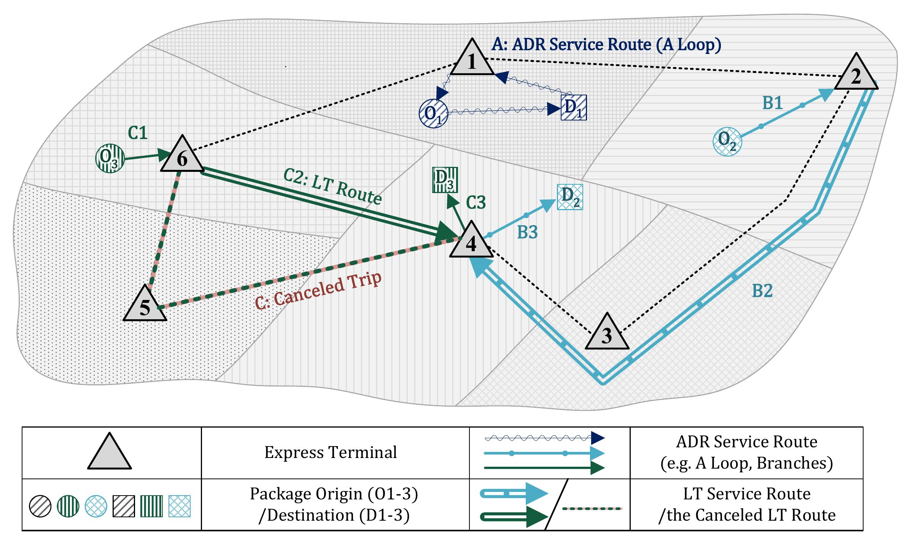
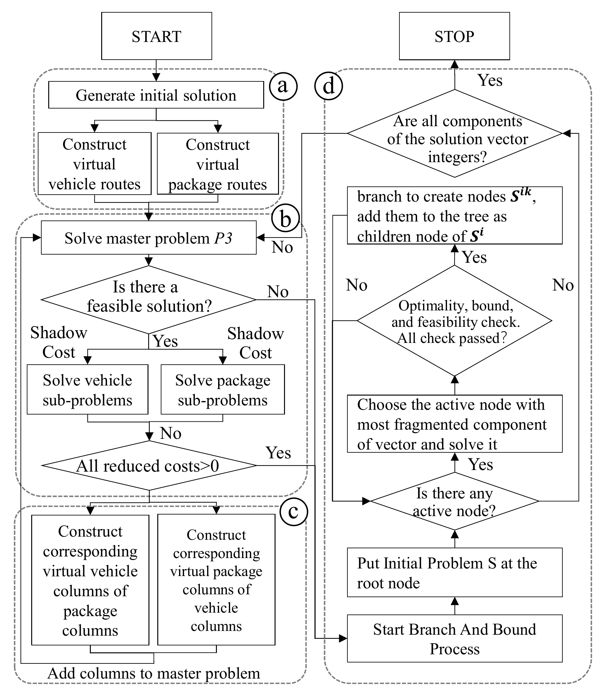

<h1 align="center">Integrated Routing of Trucks and Robots<br>for Multimodal Urban Express Logistics</h1>

<p align="center">
  <strong>Hao Zheng · Han Zheng · George Giannopoulos</strong><br>
  <a href="https://doi.org/10.1177/03611981261468762">Paper</a> ·
  <a href="READING_GUIDE.md">Reading guide</a> ·
  <a href="pseudocode/README.md">Pseudocode</a> ·
  <a href="#run-the-examples">Run examples</a>
</p>

LT–ADR coordinates large-volume trucks (LTs) and autonomous delivery robots (ADRs) to serve regular and instant delivery orders. Trucks transport packages between terminals; robots handle local pickup and last-mile delivery. The repository contains the C# research code, algorithm pseudocode and two runnable examples.

[System](#the-ltadr-system) · [Method](#routing-method) · [Paper results](#results-in-the-paper) · [Code](#code-and-algorithm-documentation) · [Citation](#citation)

## The LT–ADR system

[](assets/figures/lt-adr-system.svg)

*Figure 1 from the paper. Route A stays within one ADR service zone; routes B and C combine ADR and LT transport across zones. [View vector figure](assets/figures/lt-adr-system.svg).*

Regular deliveries follow a scheduled hub-and-spoke network. Instant orders use direct ADR service within a zone or an ADR–LT–ADR chain between zones. Joint planning allows the two services to share vehicle capacity and terminal operations.

The model determines vehicle movements and package paths subject to time windows, capacity, transfer synchronization and duty limits. Periodic replanning incorporates new orders while preserving accepted service obligations.

## Routing method

The branch-and-price-based method generates vehicle routes and package routes separately and couples them in a restricted master problem.

1. **Space-time network.** Travel, waiting, handling and transfer arcs describe LT, ADR and package movements. The objective combines routing costs and penalties for unserved orders.
2. **Initial columns.** Vehicle and package routes supply the initial pool, with service, ownership and arc-incidence coefficients.
3. **Master and pricing.** The restricted master selects compatible routes. Its dual values guide separate vehicle and package pricing problems that generate additional columns.
4. **Integer route selection.** A branch-and-bound-style search seeks an integer solution to the route-selection problem.
5. **Periodic updates.** Each decision epoch carries forward operational commitments and vehicle states, screens incoming orders and replans the remaining routes.

<p align="center">
  <a href="assets/figures/decomposition.svg">
    
  </a>
</p>

*Figure 4 from the paper: (a) initialization, (b) master and pricing, (c) construction of corresponding vehicle/package columns, and (d) branching. [View vector figure](assets/figures/decomposition.svg).*

Related specifications cover [initialization](pseudocode/ArcModel.pseudo), [master](pseudocode/GeneratingMasterProblem.pseudo), [pricing](pseudocode/GeneratingSubProblem.pseudo), [supporting vehicle routes](pseudocode/SubProblemGeneratorPas.pseudo), [coefficient extraction](pseudocode/A_B_generator.pseudo) and [branching](pseudocode/Branching.pseudo). The [controller](pseudocode/Program.pseudo) connects these modules to [periodic updates](pseudocode/DynamicUpdate.pseudo).

See the [formulation](docs/MODEL.md), [equation-to-module map](docs/PAPER_MAP.md) and [technical notes](docs/TECHNICAL_NOTES.md) for the model, implementation conditions and stopping rules.

## Results in the paper

The experiments use a **5,000-node road network**, one distribution center and ten terminals over a one-hour operating period. Six scenarios vary the demand mix and ADR fleet; each uses two LTs.

| Scenario | ADRs per terminal | Orders: instant / regular | Fulfilled: instant / regular | Orders served | Average cost, AC |
| --- | ---: | ---: | ---: | ---: | ---: |
| 1 | 3 | 150 / 200 | 100% / 100% | 350 | 4,115 |
| 2 | 2 | 150 / 100 | 100% / 100% | 250 | 4,992 |
| 3 | 1 | 150 / 50 | 62% / 100% | 143 | 6,448 |
| 4 | 2 | 150 / 0 | 84% / — | 126 | 6,858 |
| 5 | 5 | 150 / 300 | 100% / 100% | 450 | 5,076 |
| 6 | 2 | 0 / 200 | — / 100% | 200 | 3,400 |

*Scenario settings and results from the paper. AC is the composite operational cost per served order, combining travel-distance and operation-time terms. “—” indicates that the scenario has no orders of that type.*

Scenario 1 serves all 350 orders and has the lowest AC among the mixed-demand scenarios. Its AC is about 40% below the instant-only Scenario 4; the two scenarios differ in both demand mix and ADR fleet size.

The computational study considers 30 dynamic cases, with one to 30 new instant orders per decision epoch. The paper reports objective values within 5% of the Gurobi full-model results, with shorter computation times from 17 new orders per epoch. See the [paper](https://doi.org/10.1177/03611981261468762) for the computational settings, sensitivity analysis and complete results.

## Code and algorithm documentation

| Component | Contents | Entry point |
| --- | --- | --- |
| **C# source** | Network, master, pricing, branching and dynamic-update routines | [Source map](docs/SOURCE_MAP.md) |
| **Algorithm pseudocode** | Procedures and interfaces, including initialization absent from the C# source | [Module index](pseudocode/README.md) |
| **Runnable examples** | Small synthetic cases for route feasibility and dynamic updates | [Example guide](examples/README.md) |

The [implementation map](docs/COVERAGE.md) links C# routines to pseudocode; [interfaces](specs/INTERFACES.md) define their shared data structures and inputs and outputs.

## Run the examples

Install the **.NET 10 SDK** and **PowerShell 7**, then run from the repository root:

```powershell
pwsh -File examples/run.ps1
pwsh -File examples/verify.ps1
```

The examples use the standard library and include synthetic input, project files and expected output.

| Example | Demonstrates | Verified output |
| --- | --- | --- |
| [Space-time network and route feasibility](examples/01-space-time/README.md) | Travel, service and waiting arcs; time windows and load checks | Truck cost 9; robot cost 3; four infeasible route variants rejected |
| [Dynamic order update](examples/02-dynamic-update/README.md) | Order visibility, committed prefixes, vehicle state and suffix replanning | `r2` accepted; `r3` rejected; return at time 10 |

See [test results](validation/RESULTS.md) for the synthetic examples and [build instructions](docs/BUILD.md) for project requirements.

## Repository map

| Location | Contents |
| --- | --- |
| Root C# files and `ClassName/` | Research implementation |
| [`pseudocode/`](pseudocode/README.md) | Initialization, master, pricing, branching, dynamic updates and reporting |
| [`specs/`](specs/INTERFACES.md) | Data structures and module contracts |
| [`docs/`](docs/MODEL.md) | Model, source/paper maps, build instructions and technical conditions |
| [`examples/`](examples/README.md) | Two small applications with synthetic inputs |
| [`validation/`](validation/RESULTS.md) | Example results and consistency checks |
| [`assets/figures/`](assets/figures/README.md) | System and algorithm figures from the paper |

See [repository status](VERSION_STATUS.md) for the current contents.

## Citation

Hao Zheng, Han Zheng and George Giannopoulos. *Integrated Routing of Trucks and Robots for Multimodal Urban Express Logistics*. [doi:10.1177/03611981261468762](https://doi.org/10.1177/03611981261468762).

```bibtex
@article{zheng_integrated_routing,
  author = {Zheng, Hao and Zheng, Han and Giannopoulos, George},
  title = {Integrated Routing of Trucks and Robots for Multimodal Urban Express Logistics},
  doi = {10.1177/03611981261468762}
}
```
